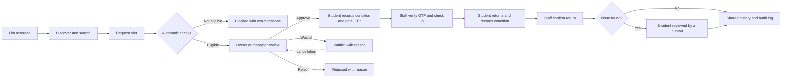
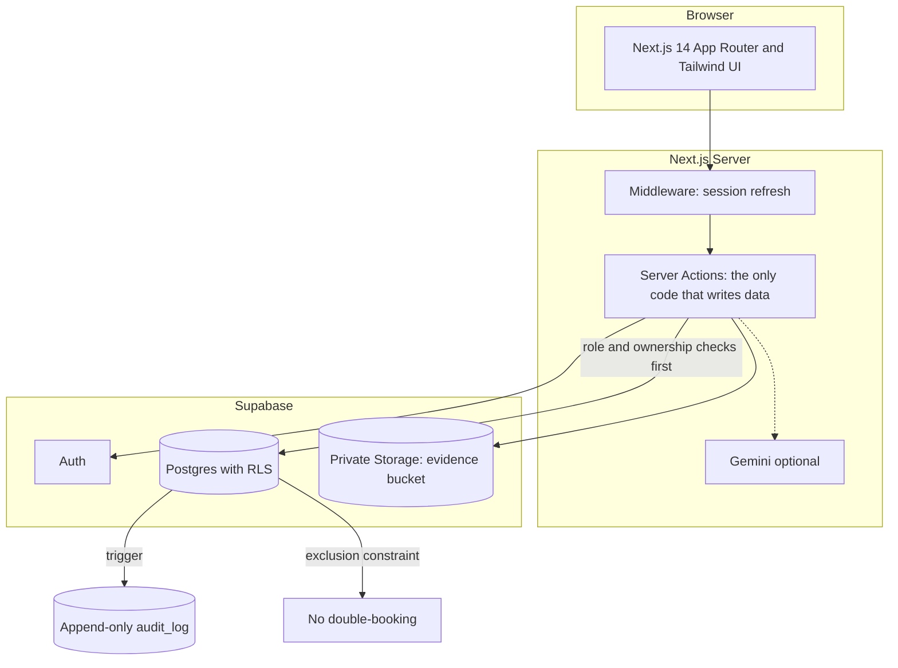

<div align="center">

# 🏛️ ResourcesHub

### Unlock your campus's underused labs, tools and rooms: fairly, safely and with a full audit trail.

[](https://nextjs.org/)
[](https://www.typescriptlang.org/)
[](https://tailwindcss.com/)
[](https://supabase.com/)
[](https://vercel.com/)

**[🔗 Live Demo](https://campus-resources-hub.vercel.app/)** · **[🎬 Demo Video](#-live-demo)** · **[🧪 Judge Walkthrough](#-5-minute-judge-walkthrough)** · **[⚙️ Setup](#-getting-started)**

</div>

---

## 📌 Table of Contents

- [The Problem](#-the-problem)
- [Our Solution](#-our-solution)
- [Live Demo](#-live-demo)
- [Key Features](#-key-features)
- [How It Works](#-how-it-works)
- [Fairness Engine](#-fairness-engine)
- [Responsible AI](#-responsible-ai)
- [Architecture](#-architecture)
- [Security and Privacy](#-security-and-privacy)
- [Tech Stack](#-tech-stack)
- [Getting Started](#-getting-started)
- [Environment Variables](#-environment-variables)
- [Demo Accounts](#-demo-accounts)
- [5-Minute Judge Walkthrough](#-5-minute-judge-walkthrough)
- [Hackathon Criteria Mapping](#-hackathon-criteria-mapping)
- [Deployment](#-deployment)
- [Project Structure](#-project-structure)
- [Team and Contribution Workflow](#-team-and-contribution-workflow)
- [Known Limitations](#-known-limitations)
- [Roadmap](#-roadmap)
- [Troubleshooting](#-troubleshooting)
- [Disclosure](#-disclosure)

---

## 🎯 The Problem

Every college has 3D printers, oscilloscopes, DSLR kits, GPU workstations, soldering stations and seminar halls that sit **idle most of the week**, while students and project teams elsewhere on the same campus **cannot afford or access** them.

Owners (lab heads, department staff) default to saying *"no"* because they fear **damage, misuse and unfair use**, and nobody knows what equipment exists or who to ask.

> **Hackathon problem statement:** *Unlock Underused Equipment and Spaces*

## 💡 Our Solution

**ResourcesHub** is a trust-first booking platform for shared campus resources. It turns *"no, I'm scared of damage"* into *"yes, with guardrails"* by building trust into every step:

| Owner's fear | How ResourcesHub answers it |
|---|---|
| "I don't know who this person is" | ID verification and admin-reviewed owner applications |
| "They aren't trained to use it" | Training proofs checked automatically on every request |
| "Two groups want the same slot" | Transparent priority score, waitlist and a database-level double-booking guard |
| "They might break it and deny it" | OTP handover with **before and after condition photos** |
| "Who decided that?" | Human decisions with mandatory reasons and an **append-only audit log** |

**No access, safety or penalty decision is ever automatic.** AI assists; humans decide.

---

## 🌐 Live Demo

| | |
|---|---|
| 🔗 **Deployed app** | [https://campus-resources-hub.vercel.app/](https://campus-resources-hub.vercel.app/) |
| 🎬 **Demo video** | `https://<your-video-link>` *(add your link)* |
| 📊 **Presentation** | [https://drive.google.com/file/d/1zzXtRD16y6zjZXo7kX28L9GQrIRXY9_j/view](https://drive.google.com/file/d/1zzXtRD16y6zjZXo7kX28L9GQrIRXY9_j/view) |

> Open the [live app](https://campus-resources-hub.vercel.app/) and sign in with the [demo accounts](#-demo-accounts). All demo data is fictional.

<!--
Add screenshots here, for example:


-->

---

## ✨ Key Features

### 🎓 For Students and Project Teams
- **Discover** equipment and spaces with search, filters and **Smart Match** (describe your need in plain English)
- **Instant eligibility feedback**: see exactly what is missing (for example, *Missing: 3D printer safety*)
- **Request** a slot with a purpose; see your **priority score** and **waitlist rank** (for example, "#2 of 3")
- **OTP check-in** and **condition report** (rating, notes, photo) before and after use
- **In-app notifications** for approvals, waitlist moves, reminders and incidents

### 🔬 For Resource Owners and Managers
- **List a resource** with location, rules, availability, required trainings and eligibility
- **Request a new training** from the admin when your item needs one that does not exist yet; once approved, tick it as required on the listing
- **Review queue** with side-by-side priority scores; approve, reject or waitlist, **always with a reason**
- **Team management**: invite managers by one-time link (7-day expiry, stored as a SHA-256 hash)
- **Check-in and return** handled by managers via OTP verification
- Three owner types shown everywhere: **College staff**, **Organisation or business**, **Individual**

### 🛡️ For Admins
- **Registration queue**: verify student ID cards and owner documents
- **Training approvals**: review certificates; approve owner-requested new trainings
- **User management**: search, filter, view profiles, **deactivate or reactivate** accounts (blocks sign-in, cancels open bookings, hides listings)
- **Audit log** and **Statistics** dashboards

### ⚖️ Trust and Safety (built-in)
- Automatic incident flags: **late return, rating drop, damage tick**
- **Human-reviewed incidents**: AI-summarised evidence (advisory only), then resolved as *no action*, *warning* or *7-day suspension*
- **Immutable audit trail**: a database trigger rejects edits and deletes

---

## 🔄 How It Works



---

## ⚖️ Fairness Engine

All rules are **visible to the user**. Nothing is hidden.

```
Priority = purpose weight + waiting time bonus − recent use penalty

  purpose weight : course project 50 · research 40 · personal 20
  waiting bonus  : +2 per day waited (max +10)
  recent use     : −2 per hour used in the last 30 days (max −30)
```

- **Weekly hour cap** and **active-booking limit** per user
- **One booking per day** on high-demand items
- When two requests compete, the owner sees **both scores**; the student sees their own breakdown
- The owner can always decide differently, but **must give a reason**, and it is logged

## 🤖 Responsible AI

AI is used **lightly** and is **never the decision-maker**.

| Use | With `GEMINI_API_KEY` | Without a key |
|---|---|---|
| **Smart Match** (resource search) | Gemini interprets natural-language needs | Keyword matching fallback |
| **Incident summary** | Gemini summarises the evidence | Plain recap fallback |

AI **never** approves, rejects, penalises or suspends anyone.

---

## 🏗️ Architecture



**Design principle:** every write goes through a server action that first checks *who the person is* and *their relationship to the resource*, and only then uses the service key. The browser never receives the service key.

## 🔐 Security and Privacy

- **Row Level Security** on every table
- **Private storage** with short-lived **signed URLs**; proofs visible only to admins
- **Service-role key is server-only**
- **Postgres exclusion constraint** makes double-booking impossible, even under race conditions
- **Append-only audit log** enforced by a database trigger
- **Role checks** on the server for every sensitive action (booking decisions, check-in, incidents)
- **No privilege self-grant**: public signup offers only Student and Resource Owner; owners are admin-verified; managers join only via owner-issued, single-use, expiring invitations
- Only necessary data collected; all demo data is fictional

---

## 🧰 Tech Stack

| Layer | Technology |
|---|---|
| Framework | **Next.js 14** (App Router, Server Actions) |
| Language | **TypeScript** |
| Styling | **Tailwind CSS**, IBM Plex fonts via `next/font` |
| Database and Auth | **Supabase** (Postgres, Auth, Storage, RLS) |
| AI (optional) | **Google Gemini** |
| Hosting | **Vercel** |

---

## 🚀 Getting Started

### Prerequisites
- **Node.js 20.6+** (`node -v`)
- A free **[Supabase](https://supabase.com)** account
- *(Optional)* a free **[Gemini API key](https://aistudio.google.com/apikey)**; the app works without it

### 1. Clone and install
```bash
git clone https://github.com/akabhishek2316/Campus-Resources-Hub.git
cd Campus-Resources-Hub
npm install
```

### 2. Create the database
1. Create a new Supabase project (save the database password).
2. Open **SQL Editor → New query**, paste the whole of [`supabase/schema.sql`](supabase/schema.sql), and press **Run**.
   It creates all tables, RLS policies, the audit-log protection, the double-booking guard and the private `evidence` storage bucket.
3. Go to **Authentication → Providers → Email** and turn **off** "Confirm email" so sign-up works instantly during the demo.
4. Go to **Project Settings → API** and copy the **Project URL**, the **anon** key and the **service_role** key.

### 3. Configure environment
```bash
# macOS / Linux
cp .env.example .env.local

# Windows PowerShell
copy .env.example .env.local
```
Open `.env.local` and fill in the three Supabase values. See [Environment Variables](#-environment-variables).

### 4. Seed demo data and run
```bash
npm run seed     # creates demo users and fictional demo data (safe to re-run)
npm run dev      # open http://localhost:3000
```

> 💡 `npm run dev` compiles each page on first open, so it feels slower. For demos use:
> ```bash
> npm run build && npm start
> ```

### Scripts

| Command | What it does |
|---|---|
| `npm run dev` | Start the development server |
| `npm run build` | Create a production build |
| `npm start` | Run the production build |
| `npm run seed` | Create or refresh demo users and data |

### Upgrading an existing database
Run the migrations in order in the Supabase SQL Editor, only for the ones your database is missing:

`migration_002_role_applications.sql` → `003_owner_manager_invites.sql` → `004_owner_verification_types.sql` → `005_student_college_id_upload.sql` → `006_account_status.sql` → `007_training_requests.sql`

A fresh database only needs the latest `schema.sql`.

---

## 🔑 Environment Variables

| Variable | Required | Description |
|---|:---:|---|
| `NEXT_PUBLIC_SUPABASE_URL` | ✅ | Supabase project URL |
| `NEXT_PUBLIC_SUPABASE_ANON_KEY` | ✅ | Supabase anon (public) key |
| `SUPABASE_SERVICE_ROLE_KEY` | ✅ | Service-role key. **Server only. Never expose or commit it.** |
| `NEXT_PUBLIC_TZ_OFFSET_MIN` | ➖ | College time zone offset from UTC in minutes (India = `330`) |
| `NEXT_PUBLIC_TZ_LABEL` | ➖ | Time zone label shown in the UI |
| `NEXT_PUBLIC_COLLEGE_NAME` | ➖ | Full college name used in header, footer, login and landing page |
| `NEXT_PUBLIC_COLLEGE_SHORT` | ➖ | Short college name |
| `NEXT_PUBLIC_SITE_URL` | ➖ | Public base URL, used for absolute manager invitation links |
| `ALLOWED_EMAIL_DOMAIN` | ➖ | Restrict sign-ups to one email domain (empty = allow any) |
| `GEMINI_API_KEY` | ➖ | Enables Smart Match and incident summaries |
| `GEMINI_MODEL` | ➖ | Gemini model name |
| `CRON_SECRET` | ➖ | Protects `/api/cron`; call with header `x-cron-secret: <value>` |

---

## 👥 Demo Accounts

All passwords: **`Demo@1234`**

| Email | Role | Best for showing |
|---|---|---|
| `student1@demo.edu` | Student (verified, **no training**) | Eligibility failure, OTP, check-in and return |
| `student2@demo.edu` | Student (verified, **has 3D printer and electronics training**) | Passing checks, competing requests |
| `student3@demo.edu` | Student (**not verified**) | Verification gate, admin registration queue |
| `applicant.owner@demo.edu` | Owner applicant (pending) | Admin review of owner documents |
| `owner@demo.edu` | Lab owner | Listing, review queue, approvals with reasons |
| `manager@demo.edu` | Manager | OTP check-in, return confirmation, incidents |
| `admin@demo.edu` | Admin | Verification, trainings, users, audit log, statistics |

**Seeded data** (dates relative to today): 6 resources; a GPU workstation booking with a waitlisted rival; a pending DSLR request; a Seminar Hall booking ready for check-in; and a returned oscilloscope booking with two open incidents.

> ⚠️ **Testing tip:** cookies are shared across tabs of one browser. Use a **second browser or a private window** to stay signed in as two different users at once.

---

## 🧪 5-Minute Judge Walkthrough

1. **Eligibility check:** Sign in as `student1@demo.edu` → **Resources** → search *"I need to print an enclosure"* with **Smart match** on. The 3D printer card shows *Missing: 3D printer safety*. Send a request: it is **blocked with the exact reasons recorded**.
2. **Competing requests:** As `student2@demo.edu`, request the **Canon DSLR kit** for the same slot as the seeded pending request (2 working days ahead, 10:00, 3 hours). The page explains the competition and shows the **priority score**.
3. **Approve with a reason:** As `owner@demo.edu` → **Requests** → **Approve** with a reason. The rival request **moves to the waitlist automatically**, with an explanation, and both students are notified.
4. **OTP check-in:** As `student1@demo.edu` → **My bookings → Seminar Hall A**. Record the **condition before use** (rating, notes, photo) and note the **6-digit OTP**. As `manager@demo.edu`, enter the OTP and **check in**.
5. **Return and incident:** As `student1@demo.edu`, return the item with a **lower rating** or tick **damaged**. An **incident opens automatically**.
6. **Human decision:** As `manager@demo.edu`, confirm the return → **Incidents** → **Summarise the evidence** (advisory only) → resolve as *no action*, *warning* or *7-day suspension* with an explanation.
7. **Transparency:** Every booking has a **timeline**. As `admin@demo.edu`, open **Audit log** and **Statistics**.

---

## 🏆 Hackathon Criteria Mapping

| Requirement | Where it lives |
|---|---|
| Listings with availability, location, rules, eligibility | `staff/resources/new`, `resources/[id]` |
| Search, filters, smart matching | `resources/page.tsx`, `lib/ai.ts` (Gemini with keyword fallback) |
| Verification and eligibility checks | ID verification, admin-reviewed training proofs, checked **server-side on every request** (`actions/bookings.ts`) |
| Approval, rejection, waitlist with reasons | `decideBooking`: a reason is mandatory and shown to the student |
| Competing requests and conflicts | Overlap checks, automatic demotion of rivals, waitlist promotion on cancellation, **database exclusion constraint** |
| Check-in and check-out | OTP check-in; before and after condition reports with photos |
| Damage, delay, incidents | Automatic flags (late, rating drop, damage), manual reports, **human resolution** |
| Notifications | In-app: approvals, rejections, waitlist moves, reminders, overdue, incidents |
| Fair usage | Weekly cap, active-booking limit, per-day limit on busy items, visible priority score |
| Roles | Student, owner, manager, admin: separate screens and server checks |
| Audit trail | Append-only `audit_log` (trigger rejects edits and deletes) |
| Privacy and security | RLS on every table, private storage, signed URLs, server-only service key |

---

## ☁️ Deployment

**Deploy to Vercel (judge-accessible link):**

1. Push the repository to GitHub (`.gitignore` already excludes `.env.local`).
2. On [vercel.com](https://vercel.com) choose **Add New → Project** and import the repository.
3. Add the same environment variables as in `.env.local`.
4. Deploy. Run `npm run seed` locally once; it writes to your Supabase project, so it applies to the deployed site too.
5. *(Optional)* Call `https://YOUR-SITE/api/cron` from a free scheduler to send reminders and overdue flags on time. Without it they run whenever anyone opens a page.

**Tip:** create the Vercel project in the **region closest to your Supabase project** (Project Settings → Functions → Region) for the best speed.

---

## 📁 Project Structure

```
Campus-Resources-Hub/
├── supabase/
│   ├── schema.sql              # tables, RLS policies, triggers, storage bucket
│   └── migration_00X_*.sql     # upgrade scripts for older databases
├── scripts/
│   └── seed.mjs                # demo users and fictional data
├── docs/
│   └── PROJECT_DOCUMENT.md     # hackathon project document (fill the brackets)
└── src/
    ├── middleware.ts           # session refresh and login redirect
    ├── lib/                    # fairness rules, time helpers, audit, AI, storage, queue
    ├── components/             # shared UI components
    └── app/
        ├── actions/            # ALL server actions (the only code that writes data)
        ├── (app)/              # signed-in pages: resources, bookings, staff, incidents, admin
        ├── login/  signup/  invite/  deactivated/
        └── api/cron/           # reminders and overdue flags
```

---

## 🤝 Team and Contribution Workflow

### Team

| Member | Role | Area |
|---|---|---|
| **Abhishek** *(Team lead)* | Foundation, database, shared libs | `supabase/`, `src/lib/`, config |
| **Member 2** | Auth and onboarding | login, signup, invites, team, notifications |
| **Member 3** | Resources and bookings | resources, bookings, requests, trainings |
| **Member 4** | Admin and incidents | admin panel, audit, stats, incidents |

> Replace the names above with your team's real names and GitHub profiles.

### Git workflow

We use **feature branches and Pull Requests**; nobody pushes directly to `main`.

```bash
git clone https://github.com/akabhishek2316/Campus-Resources-Hub.git
cd Campus-Resources-Hub
git checkout -b feature/<your-feature>

# ...make changes...
git add .
git commit -m "Clear message about what changed"
git push -u origin feature/<your-feature>
```

Then open a **Pull Request** into `main` on GitHub. The lead reviews and merges.

**Branch naming:** `feature/auth-onboarding` · `feature/resources-bookings` · `feature/admin-incidents`

**Code style:** a [`.prettierrc`](.prettierrc) is included. Please install the VS Code **Prettier** extension and enable *Format on Save* to avoid noisy diffs.

---

## ⚠️ Known Limitations

We are upfront about the scope of this prototype:

- **In-app notifications only**; no email or SMS delivery yet
- Bookings are **free**; a deposit is a rule on the listing, not a payment
- **Single college**; resource listings can be hidden or shown but not edited after creation
- The check-in **OTP is stored in plain text** (acceptable for a prototype; should be hashed in production)
- **Photo retention** (auto-delete after a period) is not implemented
- Reminders and overdue flags run on page loads or when `/api/cron` is called
- **No booking extensions** yet, and a manager can serve **one owner at a time**

## 🗺️ Roadmap

- [ ] Email and WhatsApp notifications
- [ ] IoT smart-lock handover
- [ ] Cross-college resource sharing
- [ ] Credit-based allocation
- [ ] Hashed OTPs
- [ ] Photo retention policy
- [ ] Calendar view for availability
- [ ] Edit listings after creation
- [ ] Booking extensions
- [ ] One manager for several owners
- [ ] Payments and refundable deposits

---

## 🩺 Troubleshooting

| Problem | Fix |
|---|---|
| "Invalid login credentials" for demo users | Run `npm run seed` again; make sure `.env.local` points to the **same** Supabase project where you ran `schema.sql` |
| `relation ... does not exist` | `schema.sql` was not run or failed midway. Run it again in a new SQL Editor query |
| Sign-up asks to confirm email | Turn off **Confirm email** (Authentication → Providers → Email) |
| Photos fail to upload | Confirm the private `evidence` bucket exists in Storage (`schema.sql` creates it) |
| Times look shifted | Set `NEXT_PUBLIC_TZ_OFFSET_MIN` to your offset and restart |
| `--env-file` unknown option on seed | Your Node is older than 20.6; upgrade Node |
| Sent back to login after approval | Sign out and sign in once so old cookies are replaced; use a separate browser for each role |

---

## 📜 Disclosure

- Libraries: Next.js, React, Tailwind CSS, `@supabase/ssr`, `@supabase/supabase-js`, IBM Plex fonts via `next/font`.
- No pre-existing templates or project code were used.
- All demo data is **fictional**.

---

<div align="center">

**Built for the "Unlock Underused Equipment and Spaces" hackathon.**

*Share more. Waste less. Trust by design.*

</div>
